# 3D Turbulent Flow Through a Sudden Pipe Expansion Using OpenFOAM

**CFD Engineering Portfolio Project | OpenFOAM 13 | 3D Turbulent RANS Simulation**

This repository presents an end-to-end computational fluid dynamics (CFD) project investigating turbulent flow through a three-dimensional sudden pipe expansion.

It is intended as part of my engineering portfolio, demonstrating practical experience in CFD modelling, mesh generation, turbulence modelling, numerical convergence assessment, mesh sensitivity analysis, and post-processing.

The repository includes the relevant OpenFOAM case files, simulation configurations, mesh definitions, Python post-processing scripts, extracted datasets, comparison plots, and flow-field visualisations used in the investigation. These resources are provided to document the methodology, support reproducibility, and demonstrate the complete simulation workflow.

## Repository Contents

The repository is organised into three mesh-resolution cases, supporting Python scripts, extracted datasets, and visualisation outputs.

### Simulation Cases

| Directory | Description |
|---|---|
| `sudden-expansion/` | Baseline mesh simulation case, residual history and ParaView state |
| `sudden-expansion-refined/` | Refined mesh simulation case, turbulence data and ParaView states |
| `sudden-expansion-fine/` | Fine mesh simulation case, extracted datasets, contour visualisations and post-processing outputs |
| `baseline-straight-pipe/` | Additional baseline straight-pipe case |

### Python Scripts

| File | Description |
|---|---|
| `compareVelocityPressure.py` | Extracted velocity and pressure profile comparison |
| `compareTurbulenceProfiles.py` | Turbulence profile comparison across mesh resolutions |
| `sudden-expansion/plotResiduals.py` | Baseline residual-history plotting |
| `sudden-expansion-fine/plotResiduals.py` | Fine-mesh residual-history plotting |

### Extracted Data and Comparison Results

| File | Description |
|---|---|
| `Ux_profile_comparison.csv` | Streamwise velocity comparison data |
| `p_profile_comparison.csv` | Pressure comparison data |
| `k_profile_comparison.csv` | Turbulent kinetic energy comparison data |
| `omega_profile_comparison.csv` | Specific dissipation rate comparison data |
| `nut_profile_comparison.csv` | Turbulent kinematic viscosity comparison data |
| `sudden-expansion-fine/Centreline_Ux_Fine.csv` | Fine-mesh centreline velocity data |
| `sudden-expansion-fine/Centreline_Pressure_Fine.csv` | Fine-mesh centreline pressure data |
| `sudden-expansion-fine/TurbulenceProfile_fine.csv` | Fine-mesh turbulence profile data |

### Visualisation Outputs

The repository also contains:

- Velocity and pressure profile comparison plots.
- Turbulence profile comparison plots.
- Fine-mesh velocity, pressure and turbulence contours.
- Reverse-flow visualisation.
- Inlet and expansion shoulder mesh visualisations.
- Wall y-plus distribution.
- Residual-history plots.
- ParaView state files for visualisation and further inspection.

## 1. Project Overview

This project investigates three-dimensional turbulent incompressible flow through a circular pipe with a sudden expansion. The numerical simulations are performed using **OpenFOAM 13**, employing a steady Reynolds-Averaged Navier–Stokes (RANS) approach with the **SST k-omega turbulence model**.

The main objectives are:

- Investigate flow separation and recirculation downstream of a sudden expansion.
- Analyse streamwise velocity and pressure distributions.
- Examine turbulence quantities, including turbulent kinetic energy and specific dissipation rate.
- Evaluate the influence of mesh refinement on the numerical solution.
- Assess numerical convergence and flow conservation.
- Visualise and interpret the flow field using ParaView.

Three mesh resolutions are investigated: Baseline, Refined, and Fine. The Fine mesh is used for the detailed flow-field analysis.

## 2. Geometry and Operating Conditions

The computational domain consists of a smaller upstream pipe connected to a larger downstream pipe through an abrupt expansion.

| Parameter | Value |
|---|---:|
| Upstream diameter | 0.05 m |
| Downstream diameter | 0.10 m |
| Upstream radius | 0.025 m |
| Downstream radius | 0.05 m |
| Expansion location | x = 0.50 m |
| Total domain length | 1.50 m |
| Reynolds number | 50,000 |
| Flow regime | Turbulent |
| Geometry | 3D circular pipe |

The downstream diameter is twice the upstream diameter, resulting in an area ratio of 4:1.

### 2.1 Computational Geometry

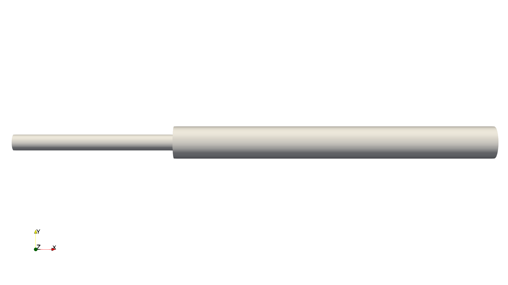
The abrupt increase in cross-sectional area causes the incoming flow to separate at the expansion edge. This produces a recirculation region and separated shear layers downstream.

## 3. CFD Methodology

### 3.1 Governing Equations

The flow is modelled as incompressible and turbulent. The governing equations are the Reynolds-averaged continuity and momentum equations.

**Continuity equation**

$$
\nabla \cdot \mathbf{U} = 0
$$

**RANS momentum equation**

$$
\nabla \cdot (\mathbf{U}\mathbf{U})
=
-\nabla p
+
\nabla \cdot
\left[
\nu_{\mathrm{eff}}
\left(
\nabla \mathbf{U}
+
(\nabla \mathbf{U})^T
\right)
\right]
$$

where:

- U is the mean velocity vector.
- p is kinematic pressure.
- nu_eff is the effective kinematic viscosity.
- nu_eff = nu + nu_t.
- nu is molecular kinematic viscosity.
- nu_t is turbulent kinematic viscosity.

### 3.2 Turbulence Modelling

The **Shear Stress Transport (SST) k-omega** turbulence model is used to represent the effects of turbulence on the mean flow.

The model combines the near-wall behaviour of the k-omega formulation with the free-stream robustness associated with k-epsilon-type modelling.

The turbulence quantities examined in this project include:

- Turbulent kinetic energy, k (m²/s²).
- Specific dissipation rate, omega (s⁻¹).
- Turbulent kinematic viscosity, nu_t (m²/s).

### 3.3 Numerical Approach

The simulations use a steady RANS formulation in OpenFOAM 13.

ParaView is used for flow-field visualisation and extraction of sampling data. Python is used for profile processing, mesh comparison, error calculations, and plotting.

### 3.4 Simulation Execution Workflow

The CFD simulations were executed using a structured OpenFOAM workflow, covering mesh generation, mesh validation, domain decomposition, parallel computation, reconstruction, and post-processing.

The main stages were:

1. **Mesh generation:** The computational mesh was generated using `blockMesh`.
2. **Mesh validation:** Mesh quality and geometric consistency were checked using `checkMesh`.
3. **Domain decomposition:** The computational domain was divided into two subdomains using `decomposePar`.
4. **Parallel simulation:** The decomposed cases were executed using OpenFOAM's parallel processing capability and MPI.
5. **Reconstruction:** The decomposed simulation results were reconstructed into a single computational domain for subsequent analysis.
6. **Post-processing:** The resulting flow fields were analysed using ParaView, while Python was used for quantitative profile extraction and mesh comparison.

### 3.5 Parallel Computing

Parallel computation was employed to distribute the computational workload across two processor subdomains.

The presence of `processor0` and `processor1` in the simulation directories confirms a two-subdomain decomposition.

The parallel execution workflow follows the OpenFOAM procedure:

**Domain decomposition**

```bash
decomposePar
```

**Parallel simulation**

```bash
mpirun -np 2 simpleFoam -parallel
```

**Reconstruction of simulation results**

```bash
reconstructPar
```

The parallel approach distributes the computational domain between processor subdomains, allowing the solver to perform calculations concurrently.

The decomposed cases and simulation outputs are retained in the repository to document the computational workflow.

## 4. Mesh Generation and Mesh Quality

Three mesh resolutions were generated to investigate the influence of spatial discretisation on the predicted flow field.

| Mesh | Approximate number of cells |
|---|---:|
| Baseline | 130,000 |
| Refined | 180,000 |
| Fine | 230,000 |

The meshes were generated using a structured block-mesh approach. Particular attention was given to the inlet region and expansion shoulder, where strong flow gradients and flow separation are expected.

### 4.1 Inlet Mesh

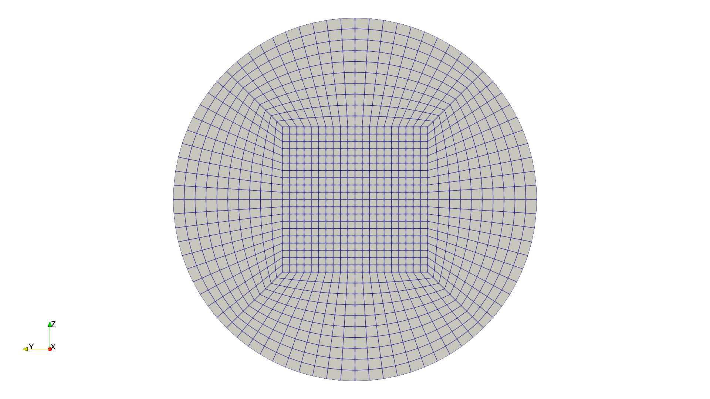

The inlet mesh provides the structured discretisation of the upstream circular cross-section.

### 4.2 Expansion Shoulder Mesh

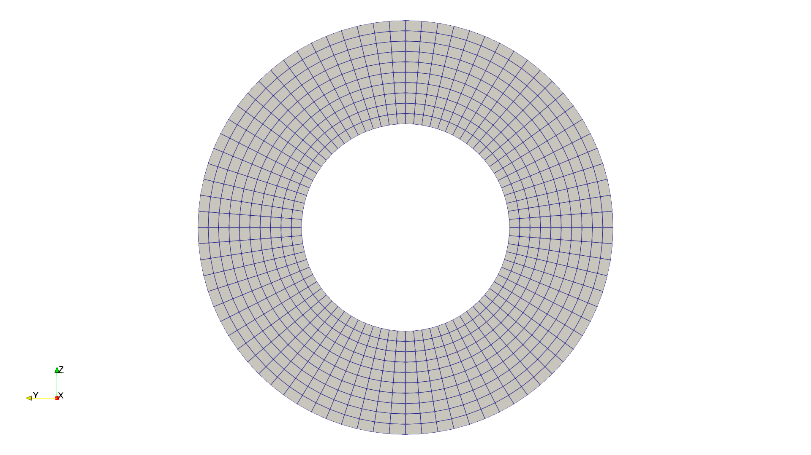

The expansion shoulder is an important region for resolving the separated shear layer and the downstream recirculation zone.

### 4.3 Mesh Quality Assessment

The generated meshes were checked using OpenFOAM's `checkMesh` utility.

The checks were used to assess mesh validity and identify potential mesh-quality issues before running the simulations.

## 5. Mesh Sensitivity and Comparison

The three mesh resolutions were compared using extracted streamwise velocity, pressure, and turbulence profiles.

The purpose of this comparison is to determine whether increasing the mesh resolution produces consistent changes in the predicted flow quantities.

### 5.1 Streamwise Velocity Comparison

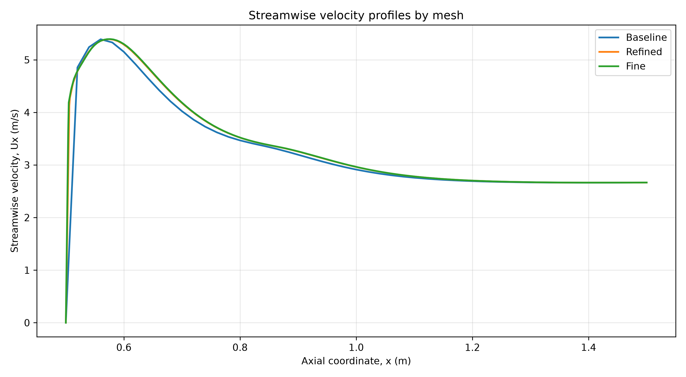

The Refined and Fine meshes show close agreement in the sampled streamwise velocity profile. The Baseline mesh exhibits larger deviations, particularly around the expansion region.

The reported error metrics for the sampled profile are:

| Mesh comparison | MAE (m/s) | RMSE (m/s) |
|---|---:|---:|
| Baseline vs Refined | 0.0764663 | 0.236607 |
| Refined vs Fine | 0.0060522 | 0.0446284 |
| Baseline vs Fine | 0.0824744 | 0.263620 |

The small Refined-versus-Fine error indicates substantially closer agreement between these two resolutions than between the Baseline and Fine meshes.

### 5.2 Pressure Comparison

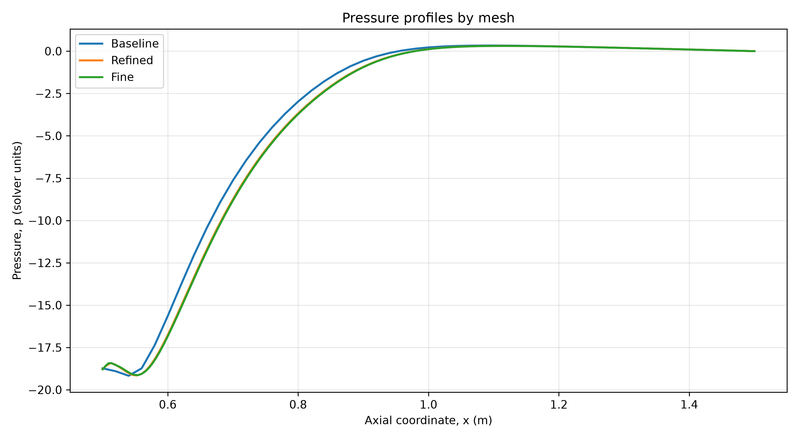

The pressure profiles from the Refined and Fine meshes show close agreement over much of the sampled domain. The Baseline mesh shows larger deviations around the expansion region.

Reported Refined-versus-Fine error metrics:

| Metric | Value |
|---|---:|
| MAE | 0.022582 |
| RMSE | 0.0357325 |

These values are expressed in the pressure field's solver units.

### 5.3 Turbulent Kinetic Energy Comparison

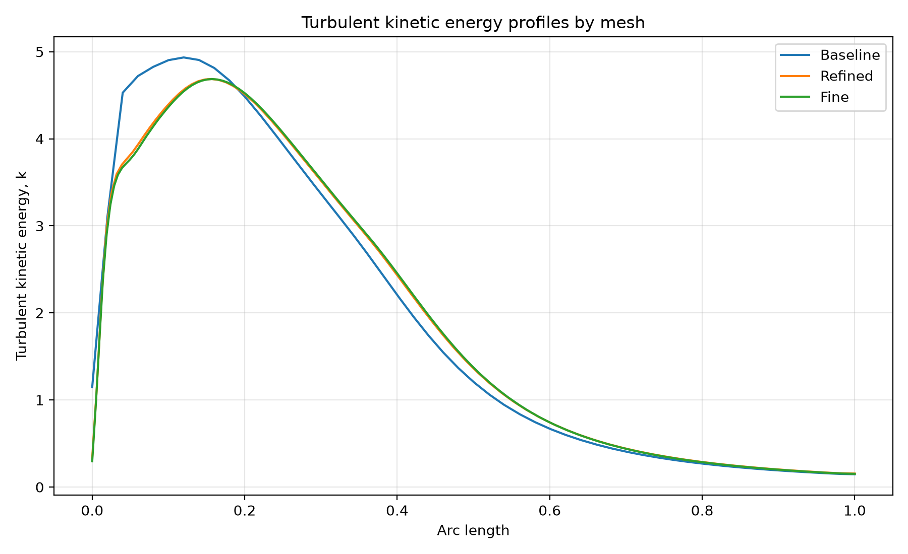

The turbulent kinetic energy profiles show similar downstream behaviour for the Refined and Fine meshes. Differences remain around the peak region, where the turbulence production is strongly influenced by the separated shear layer.

### 5.4 Specific Dissipation Rate Comparison

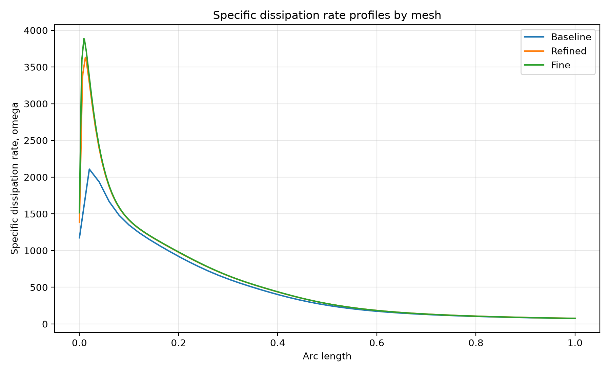

The specific dissipation rate exhibits greater sensitivity near the expansion peak than several of the other examined quantities.

The Refined and Fine meshes approach closer agreement downstream, but their peak values remain different.

### 5.5 Turbulent Kinematic Viscosity Comparison

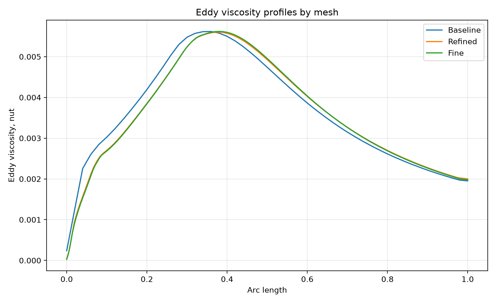

The turbulent kinematic viscosity profiles show comparatively close agreement between the Refined and Fine meshes, while the Baseline mesh exhibits larger deviations near the expansion.

### 5.6 Mesh Sensitivity Assessment

The comparison indicates that:

- The Baseline mesh produces larger deviations for several sampled quantities.
- The Refined and Fine meshes show close agreement for streamwise velocity and pressure.
- Turbulence-related quantities retain local mesh sensitivity, particularly around their peaks.
- Increasing mesh resolution improves agreement for several of the investigated profiles, but does not establish complete mesh independence for every variable.

The Fine mesh was selected for detailed flow-field visualisation and analysis.

## 6. Numerical Convergence and Flow Conservation

### 6.1 Residual Convergence

The simulations were monitored through residual histories and continuity behaviour.

For the Fine mesh, the final residual values at the end of the simulation were:

| Variable | Final residual |
|---|---:|
| Ux | 2.68029e-9 |
| Uy | 1.79976e-8 |
| Uz | 1.98729e-8 |
| Pressure | 3.4917e-7 |
| k | 5.04892e-9 |
| omega | 6.08272e-8 |

The final continuity values were:

| Continuity measure | Value |
|---|---:|
| Local continuity error | 3.91698e-6 |
| Global continuity error | -5.51286e-9 |
| Cumulative continuity error | -2.01842e-7 |

The residual and continuity behaviour support the assessment that the Fine-mesh simulation reached a numerically converged steady state.

These indicators are considered alongside the flow-field and mesh-comparison results rather than as standalone proof of physical accuracy.

### 6.2 Volumetric Flow Rate

The previously reported Refined-mesh flow-rate calculation gives:

| Quantity | Volumetric flow rate |
|---|---:|
| Inlet | -0.0196148 m³/s |
| Outlet | +0.0196148 m³/s |

The opposite signs indicate the opposite directions of the inlet and outlet surface normals. The magnitudes are equal in the reported calculation, corresponding to approximately 0% volumetric flow imbalance.

**Important:** These values represent volumetric flow rate, not mass flow rate.

Mass flow rate is calculated using:

$$
\dot{m} = \rho Q
$$

where rho is the fluid density and Q is the volumetric flow rate.

The mass flow rate is not reported here because the density used in the simulation has not yet been confirmed.

## 7. Fine-Mesh Results and Discussion

The following results are based on the Fine mesh. The contour plots show the longitudinal centre plane of the pipe.

### 7.1 Streamwise Velocity Distribution

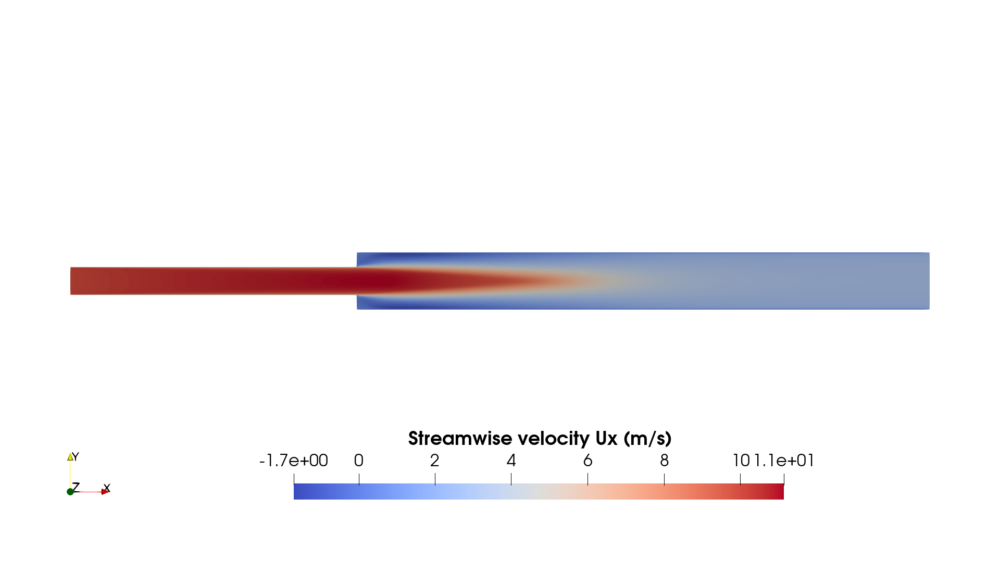

The streamwise velocity field shows the acceleration of the flow through the smaller upstream pipe and the redistribution of velocity after the sudden expansion.

A recirculation region develops downstream of the expansion, where negative streamwise velocity indicates reverse flow.

The sampled velocity profile reaches a maximum of approximately 5.3933 m/s at x = 0.576 m.

### 7.2 Pressure Distribution

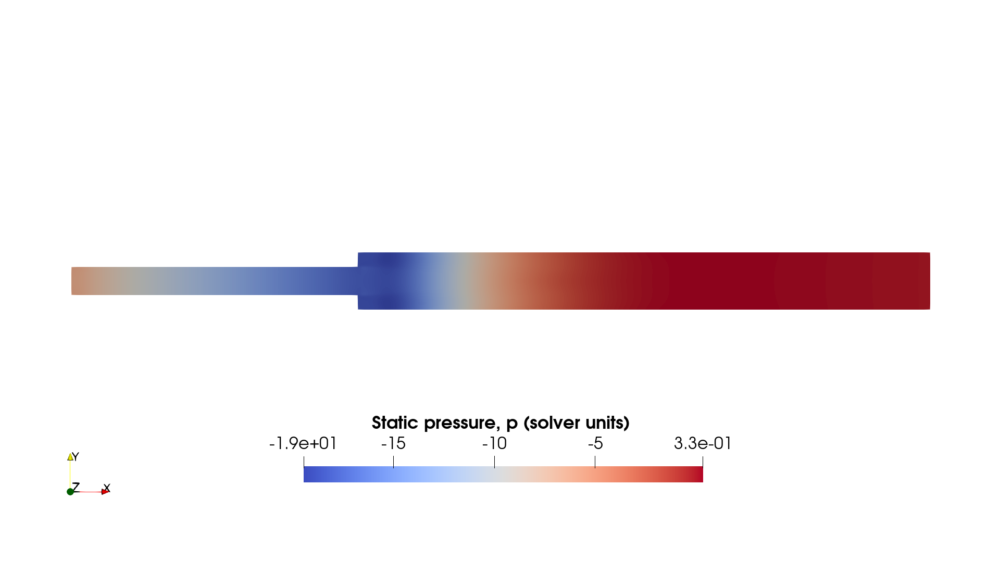

The pressure field shows a strong spatial variation around the expansion region, followed by downstream pressure recovery.

The sampled pressure profile reaches a minimum of approximately -19.131 solver units near x = 0.509 m. The maximum sampled value is approximately 0.309 solver units.

Pressure values are presented in the solver's pressure units. They should not be interpreted as dimensional pressure in Pa without confirming the field dimensions and reference convention.

### 7.3 Flow Separation and Reverse Flow

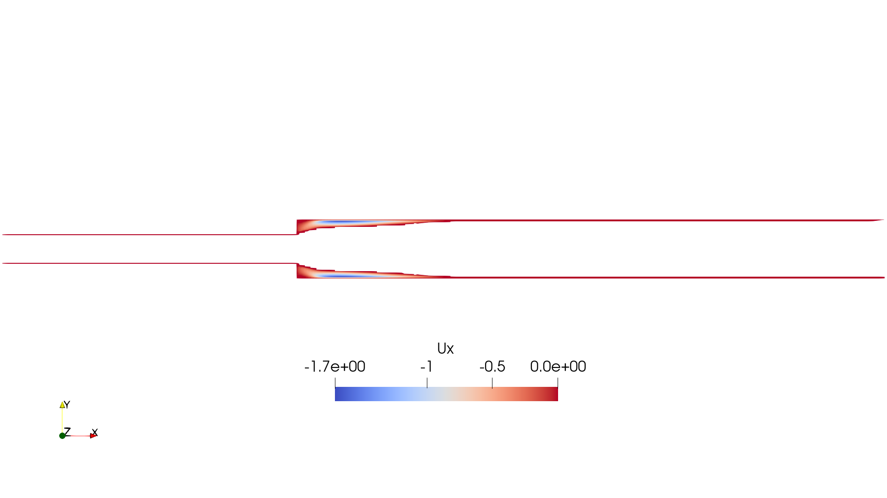

The sudden increase in pipe diameter causes the flow to separate at the expansion edge. This creates a recirculation region and a separated shear layer downstream.

Negative values of streamwise velocity identify regions of reverse flow. The results demonstrate the expected separation behaviour associated with a sudden pipe expansion.

The present analysis identifies the reverse-flow region qualitatively. A precise reattachment length has not been established.

### 7.4 Turbulent Kinetic Energy

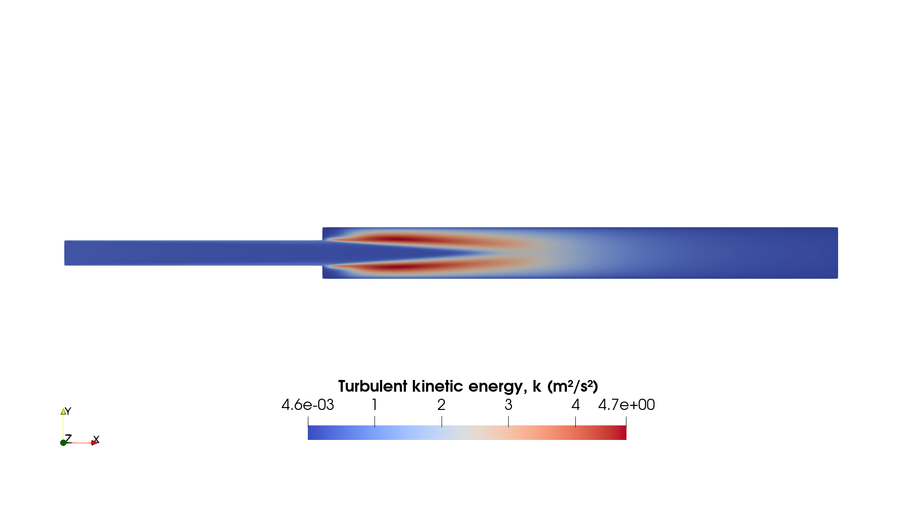

Turbulent kinetic energy is elevated in the separated shear layer downstream of the expansion.

The maximum value in the sampled profile is approximately 4.6859 m²/s² at x = 0.657 m.

This behaviour is consistent with the strong velocity gradients and turbulence production associated with the separated flow.

### 7.5 Specific Dissipation Rate

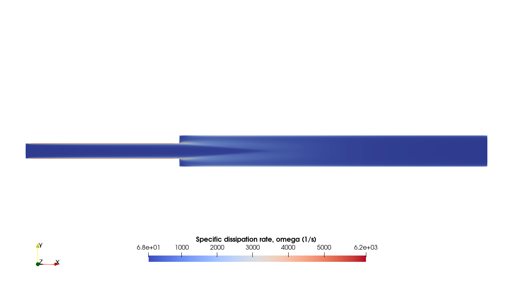

The specific dissipation rate is examined to understand turbulence-scale behaviour throughout the domain.

The sampled profile reaches a maximum of approximately 3887.4 s⁻¹ near x = 0.509 m.

The comparison between mesh resolutions indicates that the peak value remains sensitive to mesh refinement.

### 7.6 Turbulent Kinematic Viscosity

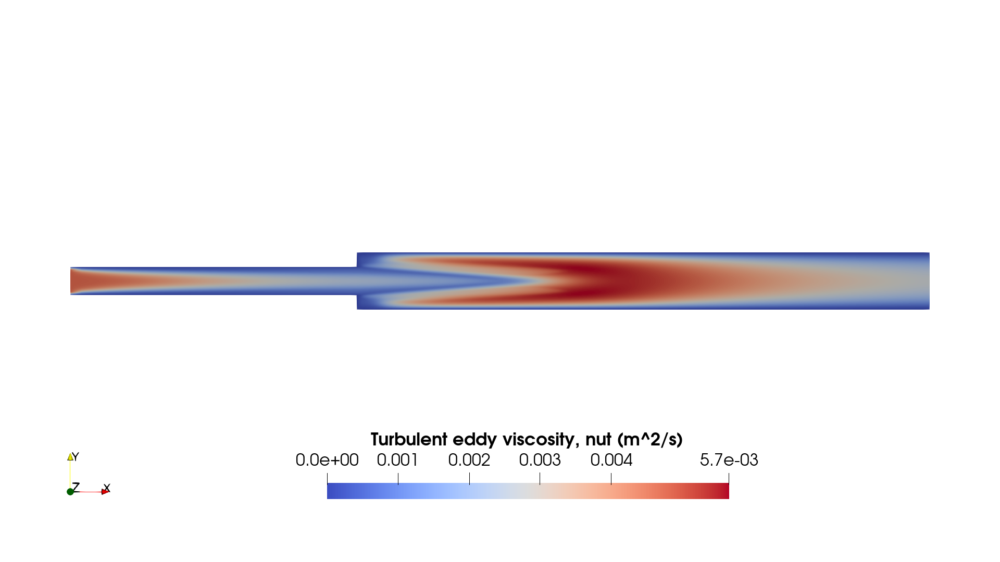

The turbulent kinematic viscosity represents the additional momentum transport associated with turbulence in the RANS formulation.

The sampled profile reaches a maximum of approximately 0.0056197 m²/s at x = 0.880 m.

Elevated values are observed in regions affected by flow separation and strong shear.

### 7.7 Wall y-plus Distribution

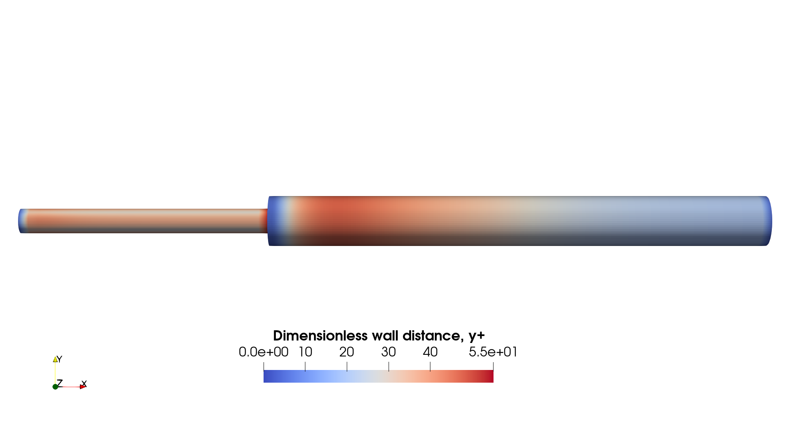

The dimensionless wall distance, y-plus, was extracted from the Fine-mesh simulation at the final simulation time.

The observed range is approximately 0–55.

The y-plus distribution is an important diagnostic for evaluating near-wall resolution and the suitability of the wall treatment used with the turbulence model. Its suitability must be interpreted in relation to the SST k-omega near-wall treatment and the spatial distribution over the wall, rather than relying on the maximum value alone.

## 8. Summary of Quantitative Findings

The following table consolidates the main numerical findings available from the current post-processing.

| Quantity | Reported value | Interpretation |
|---|---:|---|
| Maximum sampled streamwise velocity | 5.3933 m/s | At x = 0.576 m |
| Minimum sampled streamwise velocity | 0 m/s | At x = 0.500 m |
| Minimum sampled pressure | -19.131 solver units | Near x = 0.509 m |
| Maximum sampled pressure | 0.309 solver units | Sampled profile |
| Maximum sampled turbulent kinetic energy | 4.6859 m²/s² | At x = 0.657 m |
| Maximum sampled specific dissipation rate | 3887.4 s⁻¹ | Near x = 0.509 m |
| Maximum sampled turbulent viscosity | 0.0056197 m²/s | At x = 0.880 m |
| Wall y-plus range | Approximately 0–55 | Fine mesh |
| Refined-mesh inlet flow rate | -0.0196148 m³/s | Volumetric |
| Refined-mesh outlet flow rate | +0.0196148 m³/s | Volumetric |
| Reported volumetric flow imbalance | Approximately 0% | Refined mesh |
| Fine-mesh final simulation time | 3000 | Solver time units |

**Interpretation:** The velocity and turbulence values in this table are extracted-profile values, not necessarily the global minimum or maximum over the entire three-dimensional domain. The volumetric flow-rate values are from the Refined mesh and should not be interpreted as mass flow rates.

## 9. Conclusion

This project investigated three-dimensional turbulent flow through a sudden circular pipe expansion using OpenFOAM 13 and the SST k-omega turbulence model.

The main findings are:

1. The sudden expansion produces flow separation and a downstream recirculation region.
2. The velocity and pressure fields show substantial changes around the expansion region.
3. Turbulent kinetic energy and turbulent kinematic viscosity are elevated in regions associated with strong shear.
4. The Refined and Fine meshes show close agreement for several of the investigated flow quantities.
5. The peak specific dissipation rate remains more sensitive to mesh resolution.
6. The Fine-mesh simulation exhibits low final residuals and small continuity errors.
7. The reported Refined-mesh inlet and outlet volumetric flow rates have matching magnitudes.

The results demonstrate the importance of mesh refinement when investigating separated turbulent flows. They also highlight the need to assess mesh sensitivity for individual flow variables rather than assuming that agreement in one quantity guarantees agreement in all turbulence predictions.

## 10. Limitations and Future Work

Further work could improve the analysis through:

- Quantitative determination of the recirculation length and reattachment point.
- More detailed assessment of wall y-plus distribution and near-wall resolution.
- Additional mesh refinement around the expansion shoulder.
- Comparison with experimental or published benchmark data.
- Investigation of alternative turbulence models.
- Transient simulations to examine unsteady flow structures.
- Further quantitative analysis of pressure loss and turbulence production.
- Confirmation of fluid density and calculation of dimensional mass flow rate.

## 11. Tools and Technologies

- **CFD solver:** OpenFOAM 13
- **Turbulence model:** SST k-omega
- **Mesh generation:** blockMesh
- **Flow visualisation:** ParaView
- **Post-processing:** Python
- **Data analysis:** NumPy, Pandas, Matplotlib
- **Development environment:** Ubuntu 24.04 on WSL

---

*This project is an independent CFD investigation focused on turbulent flow physics, numerical modelling, mesh sensitivity, and post-processing.*